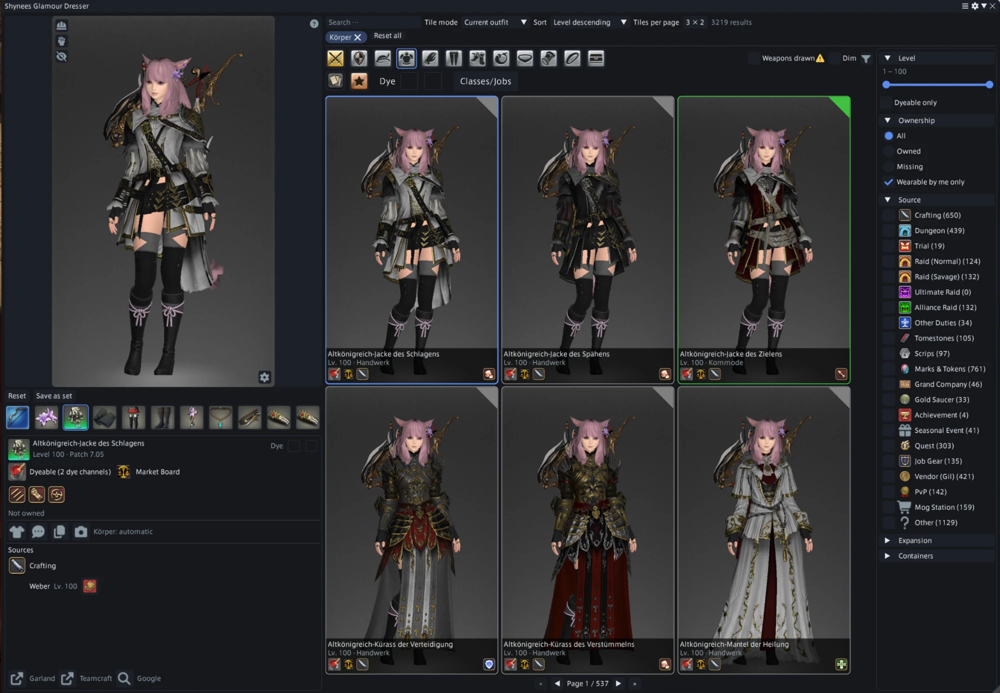
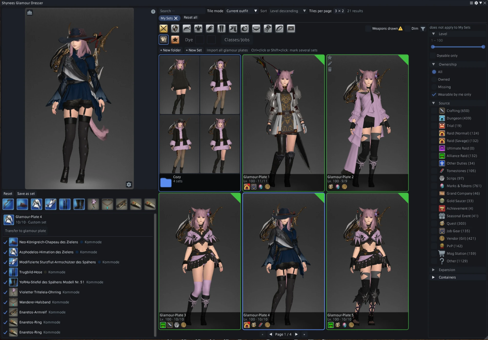

# Shynees Glamour Dresser

A [Dalamud](https://github.com/goatcorp/Dalamud) plugin for Final Fantasy XIV that shows every equippable item as a paged grid of tiles, each one rendered on your own character.

The plugin speaks your game's language: English, German, French or Japanese (you can also pick one in the settings). It is not in the official Dalamud repository; it comes from this repository's own plugin repository (see [Installation](#installation)).

## Features

- **Tile grid** of all equippable items, rendered on your character in your current outfit or in underwear, with adjustable columns and rows, several sort orders and pages rendered ahead in the direction you page.
- **Live try-on**: every item or set you click is put on, so an outfit builds up piece by piece; right-click a worn piece to take it off, and pick the hand for a ring from its tile's right-click menu. Rotate, pan and zoom (the camera stays where you put it), open the visor, draw or hide the weapon, and calibrate a camera position per slot and character for the tiles.
- **Dye preview**: two tile dyes (channel 1 and 2) render every dyeable tile in them and come along when you click a tile; the item card's dye boxes recolour the worn piece.
- **Filters** by slot, level, ownership, source (shops, quests, duties and more), jobs (gear only certain jobs can wear, several at once or whole groups such as all crafters) and dyeability.
- **Item card** with the item's sources and costs, buttons for the map, the duty finder, the recipe and the Mog Station, a chat link, copying the name, and links to Garland Tools, Teamcraft and a web search.
- **Market prices**: hovering the market board icon shows the cheapest listing on your home world and on your data center from [Universalis](https://universalis.app).
- **Ownership** across inventory, retainers, glamour dresser and armoire, including where an item is stored.
- **Gear sets** detected from the game data, shown as one tile.
- **Wishlist** for items and sets, with the missing pieces grouped by where to get them.
- **My sets**: build your own outfits with dyes, like in the glamour dresser, and sort them into folders. Start from scratch, from your current outfit or from a glamour plate, import all glamour plates at once, and transfer a set into the open glamour plate editor.

## Installation

1. In the game, open the Dalamud settings with `/xlsettings` and go to **Experimental**.
2. Under **Custom Plugin Repositories**, add `https://raw.githubusercontent.com/ShyneeAK/GlamourBrowser/main/repo.json`, tick **Enabled** and save.
3. Open the plugin installer with `/xlplugins`, search for Shynees Glamour Dresser and install it.

## Usage

`/glamourdresser` (short: `/sgd`) opens or closes the main window.

## Credits

Built on [Dalamud](https://github.com/goatcorp/Dalamud), [FFXIVClientStructs](https://github.com/aers/FFXIVClientStructs) and [Lumina](https://github.com/NotAdam/Lumina). Additional item source data comes from [LuminaSupplemental](https://github.com/Critical-Impact/LuminaSupplemental).

## AI disclosure

This plugin was developed with AI assistance. Large parts of the code, the tests and this README were written by Anthropic's Claude through [Claude Code](https://claude.com/claude-code). The author decided on the features and the design, reviewed the changes and tested every version in the game.

## License

MIT, see [LICENSE](LICENSE).

FINAL FANTASY is a registered trademark of Square Enix Holdings Co., Ltd. This project is not affiliated with or endorsed by Square Enix.
